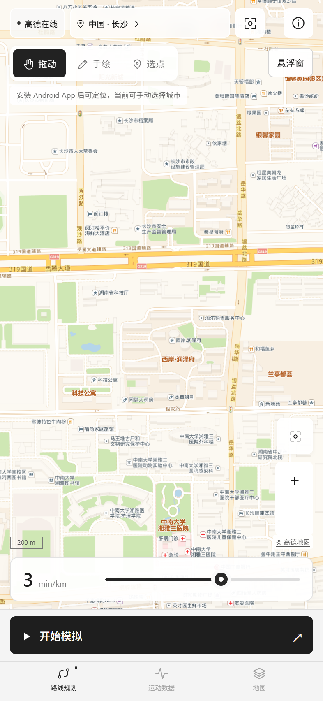

# 行迹 STRIDE · Android 地图与轨迹模拟

可安装 APK：[下载 1.3.2](https://github.com/hxyz486/stride-android/releases/download/v1.3.2/stride-1.3.2.apk)。支持 Android 8.0 及以上，黑白按钮与面板、彩色地图，无广告。默认使用高德在线地图查看全国街道，也可切换内置离线概览或导入区域离线地图。当前为本地签名的开发版本。



## 已实现

- 默认按当前视野加载高德在线街道地图，显示道路、建筑与中文地名，细节取决于当地数据覆盖。支持 39 个城市/地区快捷定位，也可输入 GPS WGS84 的“纬度,经度”。
- 保留原首页上方的在线/离线、城市、当前位置、拖动/手绘/选点及缩放控件；只精简下方的统计和文字面板，留下速度条与开始按钮。底部导航和“运动数据”页保留，默认在线并尝试定位当前位置。
- 左上角切换在线街道、内置离线全国概览或已导入 MBTiles；切换保留 WGS84 路线。长按地图可使用撤销、清空、示例路线或全屏编辑等辅助操作。
- 参照提供的效果图制作的全屏编辑页：设起点、点击添加编号途经点、连续手绘、撤销、清空、完成；支持单程/原路往返。普通模式画线，双指移动缩放，另有移动模式。
- 配速范围 **0–5 min/km，默认 3 min/km**，步长 0.1。单位是分钟/公里，3 表示 3 分钟跑 1 公里，5 表示 5 分钟跑 1 公里；正数越小越快。0 表示原地停留：坐标、步数与模拟晃动停止，活动计时继续。回放时可调速、暂停、继续或结束。
- 在线地图按屏幕像素密度选择更高一级图块，并避免小数缩放时拉伸低级别图块；保留彩色地图。栅格来源最高支持 19 级，达到上限后仍受原始分辨率限制。
- Android 官方系统模拟定位，GPS 与 network 测试提供者，结束或正常销毁后移除本应用添加的测试提供者。位置保留系统官方模拟标记。
- App 内合成三轴角速度（rad/s）、步频、步数、经纬度和回放进度。
- “运动数据”页可切换“手机实测”，在前台读取真实陀螺仪；设备具备步伐传感器且授予活动识别权限时，可查看实测步数与步频。缺少硬件或权限时显示对应状态。
- 回放时保持 CPU 唤醒，降低息屏导致的定位更新中断；暂停、原地停留与结束时释放唤醒锁。调配速时立即提交当前位置，“运动数据”页显示系统提交次数和时间差。百度等地图自身的接收、缓存和刷新策略可能继续产生延迟，本次未在用户手机验证。
- 用户授权的系统悬浮窗：首页增加独立开关，开启状态本地保存，离开 App 后显示，可拖动，可开始、暂停、继续，也可返回 App；关闭悬浮窗不会结束当前回放。通知栏也可暂停/继续/结束回放。
- 导入栅格 MBTiles（PNG/JPEG/WebP，Web Mercator，TMS 默认或 metadata 中 scheme=xyz）。支持不超过 2GB 的单个地图包。导入后复制到应用私有目录，可断网使用。
- 路线和参数本地保存；通过系统文件选择器导出 JSON 路线和模拟会话。会话采样约每秒一次，最多保存 7200 个样本。

## 首次使用

1. 将 APK 传到手机安装，根据系统提示允许此安装来源。
2. 保持联网，首次打开时允许位置权限，首页会尝试定位当前位置。在左上角选择拖动、手绘或选点；可直接选择城市或定位重试。长按地图可清空、撤销或载入示例。速度在底部调整，点开始回放。
3. 在系统设置 → 关于手机中连续点击版本号，启用开发者选项。在“选择模拟位置信息应用”中选择 **行迹 STRIDE**。
4. 打开系统位置信息开关，长按地图，在工具菜单选择“系统模拟定位”并开始，允许**精确位置**权限。首次可先选“App 内预览”，无需模拟定位授权。
5. 要在退出后控制，点击首页右上角 **悬浮窗**，或在“运动数据”页打开 **退出后显示悬浮窗**，在系统页面允许“显示在其他应用上层”，然后返回 App。
6. 返回桌面即可看到悬浮窗，用开始/暂停按钮控制。若尚未授予模拟定位权限，悬浮窗会打开 App 完成系统授权。允许回放通知便于在通知栏结束回放。
7. 部分手机需要在电池设置里允许后台运行。划掉任务通常不会结束前台服务；**强制停止、系统杀进程、重启手机会结束回放和悬浮窗**，回放不会自动恢复；重新打开 App 时，已授权并开启的悬浮窗会恢复。
8. 长按地图选择“地图管理”可导入 MBTiles；也可点图源按钮切换全国离线概览。切换来源不会清空路线。

## 地图范围与传感器限制

**全国街道通过网络按当前视野加载，APK 没有包含全国街道离线包。** 在线来源为高德公开栅格瓦片服务，使用国内域名 `webrd01.is.autonavi.com`，无需在当前开发版中填写地图 Key。当前未接入高德正式地图 SDK，该公开服务的长期可用性与正式 API 支持没有保证。开发网络对北京、长沙、上海的实际街道图块抽样均返回 HTTP 200 PNG；独立 Chrome 的长沙实际在线视野也已验证 24/24 图块加载并显示，未拦截或替换图块。完整验收范围见 [TESTING.md](TESTING.md)。首次查看某一区域需要联网，道路、建筑、地名与更新程度随地区不同。服务和当前网络都可能导致加载失败，界面提供重试与离线概览入口。WebView 按 HTTP 缓存头处理已访问瓦片，缓存可能被系统清理，不能据此保证断网可用。本项目不提供预取、批量下载或全国离线下载功能。

内置离线概览只有省级边界与城市定位，没有街道细节。离线详细地图需在“地图”页导入有权使用的城市/区域栅格 MBTiles，不支持 PBF 矢量 MBTiles。若地图包未包含当前缩放级别或区域，该处不会出现详细瓦片。路线绘制、保存和回放本身可离线使用。

Android WebView 的联网例外仅允许 `webrd01.is.autonavi.com` 的 HTTPS 瓦片请求，界面资源随 App 安装。本 App 没有接收路线的服务端，不上传完整路线或会话；在线地图请求中的瓦片坐标会向地图服务方透露当前查看区域。点击地图署名会交由系统浏览器打开高德地图网站。地图数据来源与服务说明见 [SOURCES.md](app/src/main/assets/maps/SOURCES.md)。

路线、城市坐标输入、回放与导出统一使用 GPS WGS84 经纬度。高德在线底图按 GCJ-02 显示，绘制时自动反算回 WGS84；切换地图不会改写保存的路线。离线 MBTiles 应为标准 WGS84 / EPSG:3857 地图，未经处理的 GCJ-02/BD-09 离线包可能偏移。全国概览来自 DataV GeoAtlas 原始行政区数据，只用于开发演示与区域选择，不用于导航；概览数据未作实时更新。

**读取陀螺仪不等于可以修改陀螺仪。** Android 普通应用没有向其他应用注入陀螺仪读数的公开权限。“App 内模拟”的三轴角速度、步数与步频由内部步态模型推算，仅作预览和导出；“手机实测”读取本机传感器，不向其他应用写入传感器或步频数据。本 App 不修改系统真实传感器，不包含 root、Hook 或隐藏模拟标记功能。其他应用是否接受官方模拟位置取决于其实现。

## 构建

方案一：用 Android Studio 打开本目录，使用 JDK 17 和 Android SDK 35，同步 Gradle（AGP 8.7.3），执行 `:app:assembleDebug`。工程不依赖第三方 Android 库。

方案二：Windows 上安装 Python 3 和 JDK，设置 `JAVA_HOME`，执行：

```powershell
python tools/build.py --test
node tools/ui-test.cjs
python tools/build.py
```

`build.py` 会从 Google 官方地址准备平台 35 和构建工具 35，使用 javac、aapt2、D8、zipalign 和 apksigner 生成 APK。首次需要联网，后续使用 `.toolchain/` 缓存。本地签名密钥保存在 `.toolchain/debug.jks`，密码为开发用途的 `android`；发布时请换用自己的签名与发行流程。此路径不提交版本控制。

`ui-test.cjs` 使用本机独立的无头 Chrome 与 Playwright；Playwright 路径在脚本顶部按本机环境修改。脚本不使用用户浏览器登录状态。核心算法测试直接运行纯 Java，不依赖 Android。

## 工程结构

- `app/src/main/java/cn/stride/offline/RouteEngine.java`：路线距离、插值、配速、步态模型。
- `SimulationService.java`：前台回放服务、系统模拟定位、会话采样。
- `OverlayService.java`：系统悬浮控件及后台开始/暂停控制。
- `MainActivity.java`：本地 WebView、权限、文件导入导出；允许高德指定域名的 HTTPS 瓦片请求，限制外部资源和导航。
- `MotionMonitor.java`：前台真实陀螺仪、步数与步频诊断。
- `OfflineTiles.java`：只读 MBTiles。
- `app/src/main/assets/`：内置界面、画布地图与瓦片加载器、WGS84 / GCJ-02 显示转换、离线全国概览。
- `tests/`、`tools/`：算法检查、界面交互验证、构建脚本。
- `dist/`：APK、SHA256 校验和、界面截图。

Android 的 mock location、权限、后台服务、悬浮窗属于设备相关能力；浏览器页面只提供内部预览，不能代替 Android 实机验证。
