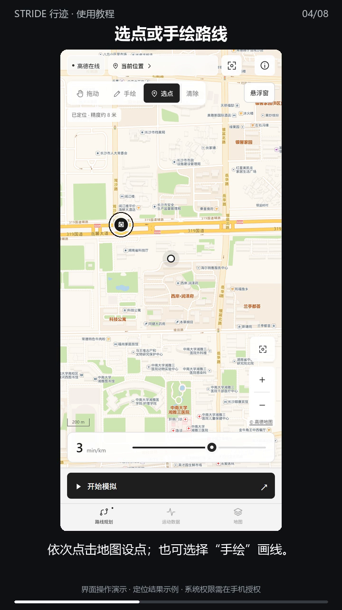

# 中文视频教程

[观看／下载 53 秒视频](https://github.com/hxyz486/stride-android/releases/download/v1.3.4/stride-tutorial-1.3.4.mp4) · [字幕 SRT](https://github.com/hxyz486/stride-android/releases/download/v1.3.4/stride-tutorial-1.3.4.srt)



视频依次演示：开启定位权限、首次配置模拟定位、自动定位、选点和手绘入口、清除路线、0–5 min/km 配速、开始／暂停与悬浮窗授权说明，以及陀螺仪实际能力。

地图来自真实高德网络，当前位置为示例坐标。视频演示捆绑界面；手机系统授权步骤使用文字提示，没有录制或伪造真实系统权限弹窗。陀螺仪曲线为 App 内模拟，不修改系统传感器。

## 重新生成（Windows）

需要 Python Pillow、Playwright、Chrome 以及系统 Microsoft Huihui Desktop 中文语音。图块截图需要联网。

```powershell
python -m pip install --target .toolchain/video-python imageio-ffmpeg
powershell -NoProfile -File tools/tutorial-narration.ps1
node tools/tutorial-capture.cjs
python tools/tutorial-render.py
```

Playwright 与 Chrome 路径可通过 STRIDE_PLAYWRIGHT、STRIDE_CHROME 配置。MP4 和 SRT 写入 dist，截图及语音中间文件写入 build/tutorial，均不提交到 Git。720×1280 H.264/AAC 输出适合手机播放，语音使用系统合成，非真人录音。
